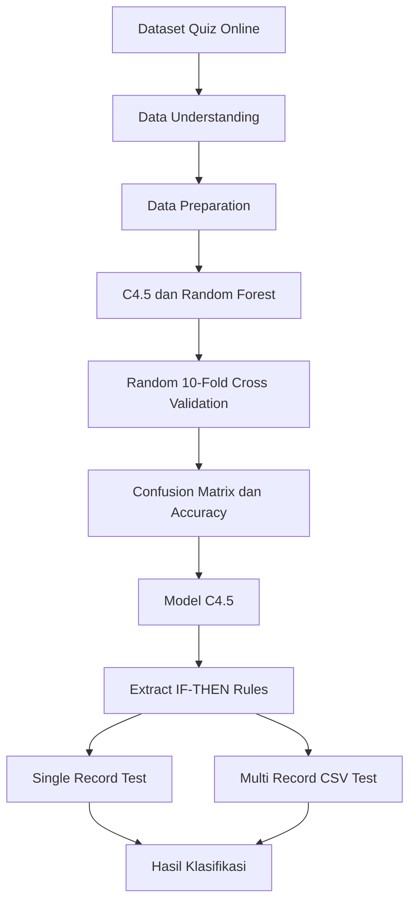

# High Level Design (HLD)

## 1. Arsitektur
Sistem menggunakan arsitektur web sederhana dengan pemisahan antarmuka, API, layanan data, layanan pemodelan, dan penyimpanan.

```text
Browser
   |
   v
Frontend
   |
   v
REST API / Backend
   |
   +---- Dataset Service
   +---- Data Preparation Service
   +---- Decision Tree C4.5 Service
   +---- Random Forest Service
   +---- Evaluation Service
   +---- Rule/Prediction Service
   |
   v
Database
```

## 2. Komponen
### Frontend
Menampilkan dataset, konfigurasi eksperimen, evaluasi, pohon/rule, single record test, dan multi-record CSV test.

### Backend
Menangani autentikasi, dataset, pemodelan, evaluasi, rule, dan prediksi.

### C4.5 Service
Membentuk Decision Tree C4.5 dan menyediakan rule IF-THEN untuk deployment.

### Random Forest Service
Membentuk model Random Forest untuk pembanding pada tahap modelling/evaluation.

### Evaluation Service
Menjalankan random 10-fold cross-validation dan menghitung confusion matrix serta accuracy.

### Rule/Prediction Service
Menerapkan rule C4.5 terhadap input single record atau multi-record.

### Database
Menyimpan pengguna, dataset, model, evaluasi, rule, dan hasil prediksi.

## 3. Alur Klasifikasi


